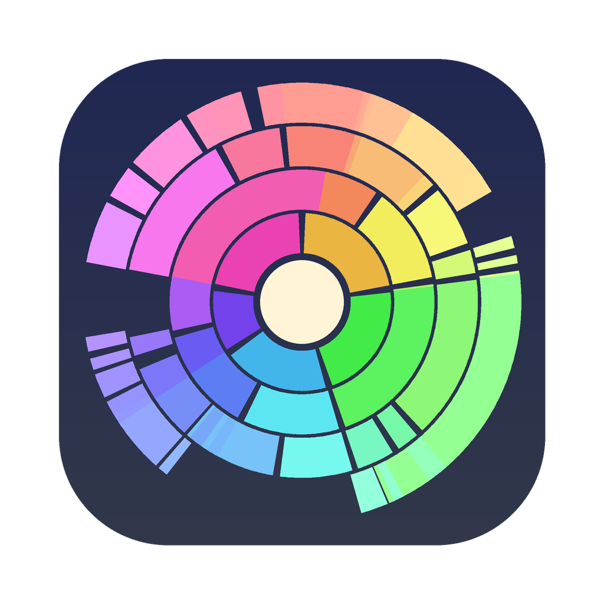

# Dandelion

A free and open-source disk space visualizer for macOS, in the spirit of DaisyDisk.

**[Download Dandelion.dmg](https://github.com/cwxyz-tech/dandelion/releases/latest/download/Dandelion.dmg)** · [Project page](https://cwxyz-tech.github.io/dandelion/) · macOS 14 or later · Apple silicon and Intel

Scan a disk or folder, see everything as an interactive sunburst, find what's eating your space, and clear it out.



## Features

- **Fast scanning.** Uses `fts` (the walker behind `du`) split across every CPU core.
- **Interactive sunburst.** Click a folder to dive in, click the middle to go back up, hover anything to see its size.
- **Sorted list** of the current folder alongside the chart, with breadcrumbs back up the path.
- **Collector.** Drag files and folders to the bar at the bottom, then move them all to the Trash at once. Nothing is ever deleted outright; it all goes to the Trash.
- **Quick Look** (Space), Reveal in Finder, Open, Copy Path from the right-click menu.
- **Hidden space.** The part of the disk the scan can't see (the sealed system volume, snapshots, purgeable caches, unreadable folders) shows up as a grey slice, so the chart adds up to what the disk says is used.
- **Accurate sizes.** Counts the space actually allocated on disk, and counts hard-linked files once.
- Native SwiftUI, Apple Silicon and Intel, light and dark mode. No network access, no analytics, no accounts.

## Build it

You only need Apple's free Command Line Tools (not the full Xcode):

```sh
xcode-select --install     # once
./build.sh                 # makes build/Dandelion.app
```

`ARCHS=arm64 ./build.sh` builds for Apple Silicon only, which is faster.

`./make-dmg.sh` then packs it into `build/Dandelion.dmg`, the usual "drag the app onto Applications" disk image.

Then drag `build/Dandelion.app` into Applications. An app you build yourself opens without any Gatekeeper warning.

## Downloading a build instead

Every push is built on a Mac by GitHub Actions (`.github/workflows/build.yml`). Tagging a commit `v1.1` publishes a release with `Dandelion.dmg` and `Dandelion.zip`.

Open the .dmg and drag Dandelion onto Applications. Downloaded builds are ad-hoc signed, not notarized, so the first launch gets blocked. To open it: try to open it once, then go to **System Settings → Privacy & Security** and click **Open Anyway**. Or in Terminal:

```sh
xattr -dr com.apple.quarantine /Applications/Dandelion.app
```

## Full Disk Access

macOS hides some folders (Mail, Messages, Safari, other apps' containers) from every app unless you allow it. Dandelion shows a banner when it can't see them. To see everything: **System Settings → Privacy & Security → Full Disk Access**, turn on Dandelion, then rescan.

## How it works

| File | What's in it |
| --- | --- |
| `Sources/Scanner.swift` | The parallel disk scanner |
| `Sources/Model.swift` | The file tree, disk list and formatting |
| `Sources/AppState.swift` | Scanning, navigation, the collector, Trash |
| `Sources/Sunburst.swift` | Laying out and drawing the chart, hit testing |
| `Sources/Views.swift` | The screens |
| `Sources/App.swift` | App entry point and menus |
| `docs/` | The project page (GitHub Pages) |

On the startup disk, Dandelion scans the Data volume (`/System/Volumes/Data`), which is where all your files live. Other mounted disks aren't counted, even if they're mounted inside the folder being scanned.

## License

MIT. See [LICENSE](LICENSE).
